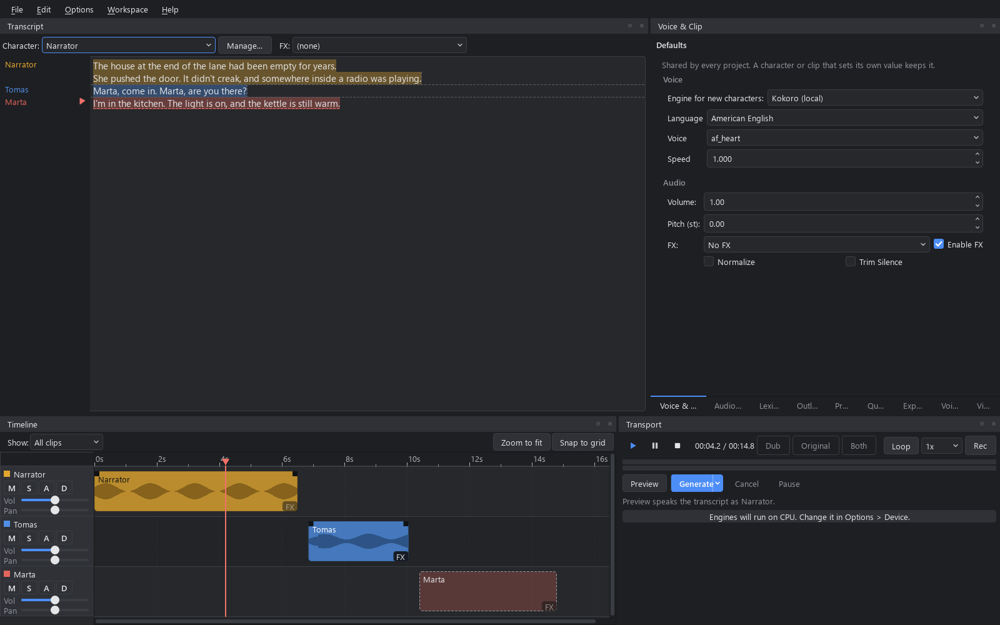

# KokoroGUI

[](https://github.com/CoffeeMethod/KokoroGUI/actions/workflows/tests.yml)
[](LICENSE)
[](https://www.python.org/downloads/)

A text to speech editor where the script is the project. Write or import the text, give each line a character,
and the audio lands on a timeline you can mix and export. Change a word and only that line generates again.
Everything runs on your own machine, free and open source.



*(demo sounds better in `.wav` but GitHub doesn't support that so it's kinda bad)*

https://github.com/user-attachments/assets/c75e7141-5d73-40f4-b182-d4f5bc49ad1e

## Why use it

-   **Edit text, not audio.** Fix a typo and that one clip regenerates. The rest of a ten-hour book stays as it is.
-   **A full cast.** Every character gets its own voice and engine: Kokoro's voices in 8 languages, Audio8 voice
    cloning, or LuxTTS. `[Marta]:` at the start of a line hands it to Marta, and Attribute Dialogue does it for a whole novel.
-   **A real mixer.** One track per character with faders, pan, automation, fades, music beds that duck under speech,
    and 17 effects applied at playback, so moving a slider never costs a regenerate.
-   **Built for audiobooks.** Import a `.pdf` or `.epub`, let the queue fill it in while you keep editing, have Whisper
    proof the audio against the text, and export an M4B with chapters or files that pass ACX, Apple Podcasts,
    Spotify and YouTube loudness checks.
-   **Dubbing and podcasts too.** Import subtitles, fit each line to its slot, play against the original video, and
    export stems, transcripts and show notes.
-   **One file.** A `.tbaw` holds the text, the audio and every voice it uses, so it opens on another machine.
-   **Scriptable.** A command line and an MCP server render a tagged script to audio without opening the window.

The [docs site](https://coffeemethod.github.io/KokoroGUI/) walks through each workflow and every setting.

## What's new in 4.0.0-beta.3

-   Generate is a queue: a book fills in eight clips at a time while you edit, even in another project
-   A book import wizard, an Outline tab for chapters and a Proof tab that checks the audio with Whisper
-   Loudness normalizing, delivery presets, stems, transcripts, tags and M4B export
-   A [command line and MCP server](docs/cli.html), and LuxTTS as an optional engine
-   Find and replace, several clips selected at once, guide takes, filler word removal and 0.5x to 2x playback
-   A tooltip on every control, and a window that can be translated (Options > Language)

The [changes page](docs/changes.html) lists everything, with what each update does to existing projects.

## Install

You need Python 3.11+ and [eSpeak NG](https://github.com/espeak-ng/espeak-ng). M4B export also needs
[ffmpeg](https://ffmpeg.org/download.html) on your PATH.

```bash
git clone --branch 4.0.0-beta.3 --depth 1 https://github.com/CoffeeMethod/KokoroGUI.git
cd KokoroGUI
python -m venv .venv
.venv\Scripts\activate          # Windows
source .venv/bin/activate       # macOS / Linux
pip install -r requirements.txt
python main.py                  # or double-click run.bat on Windows
```

If `torch` gives you trouble, install it from [pytorch.org](https://pytorch.org/get-started/locally/) for your OS
and GPU. Models download from Hugging Face the first time you use them, and the app asks before the 1.6 GB
Whisper download. The [install guide](docs/index.html#install) covers smaller Whisper models, the offline Vosk
engine and running without Kokoro.

Want 3.2.0, the old one-text-box app? Clone with `--branch 3.2.0`. Only `presets/` and `custom_voices/` carry over.

## Tests

```bash
pip install -r requirements-test.txt
pytest                                     # fast suite, mocked, no model needed
pytest -m integration tests/integration -s # real generation, needs eSpeak NG
```

## Contributing

See [CONTRIBUTING.md](CONTRIBUTING.md). Pull requests go to the latest release branch, not `main`. Report security
issues through the repository's Security tab, not Issues ([SECURITY.md](SECURITY.md)).

## Built with

[Kokoro](https://github.com/hexgrad/kokoro),
[Audio8-TTS](https://huggingface.co/Audio8/Audio8-TTS-Preview-0.6b),
[Pedalboard](https://github.com/spotify/pedalboard),
[PySide6](https://doc.qt.io/qtforpython/), PyTorch, SoundFile and sounddevice, PyPDF and
EbookLib.
